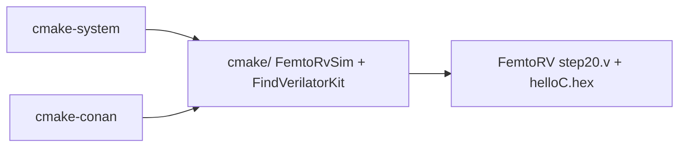

# CMake dual-tree (FemtoRV Verilator hello)

Optional CMake wrappers around the **existing** FemtoRV teaching-SoC
Verilator path (`FemtoRV/TUTORIALS/FROM_BLINKER_TO_RISCV/`). Same shape as
[weiwan-gmail/rtl-learning-plan](https://github.com/weiwan-gmail/rtl-learning-plan)
(`cmake-system/` + `cmake-conan/` + shared `cmake/`).

Original Make / `run_verilator.sh` / `run.sh` are **unchanged**.



`cmake-system` uses the distro Verilator; `cmake-conan` exports the in-tree
recipe (withlimon PE on Windows, packages the system kit on Linux). Both
call the same `femtorv_sim_setup()` which verilates the teaching SoC.
Linux builds `firmware.hex` through the existing Make path; Windows (and
`-DFEMTORV_HEX_VIA_CMAKE=ON`) use a CMake-native RISC-V GCC recipe or the
committed golden hex — GNU make is not required for the cmake sim.

```
cmake/                 shared Verilator find, MSVC flag strip, sc_time_stamp,
                       withlimon fallback config, FemtoRV sim + PASS runner
cmake-system/          system Verilator (no Conan)
cmake-conan/           Conan 2 + local recipes/verilator (withlimon PE /
                       Linux system kit)
```

Linux (proven):

```bash
# same firmware hex as `cd FemtoRV && make test_verilator_hello`
cmake -S cmake-system -B build-system -DCMAKE_BUILD_TYPE=Release
cmake --build build-system --target sim
ctest --test-dir build-system --output-on-failure

export PATH="$HOME/.local/bin:$PATH"   # pip --user conan 2.34
conan profile detect --force
cmake -S cmake-conan -B build-conan -DCMAKE_BUILD_TYPE=Release
cmake --build build-conan --target sim
ctest --test-dir build-conan --output-on-failure
```

Expect `Hello, world !` / `PASS` / `SIM DONE` / `ALL TESTS PASSED.`

Windows (PC2023, Visual Studio / MSVC): GNU make is **not** required for
the Verilator cmake sim. Drive `verilator_bin.exe` (PE). See
[`cmake-system/WINDOWS.md`](cmake-system/WINDOWS.md).

```bat
cd cmake-system
powershell -File .\build_sim.ps1 -Generator "Visual Studio 17 2022"
```
