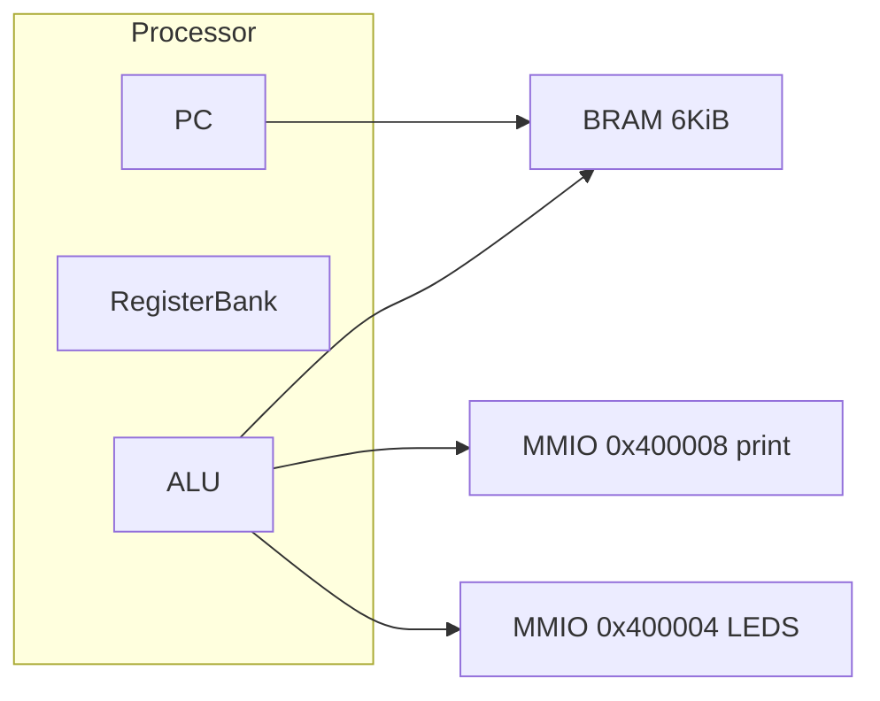
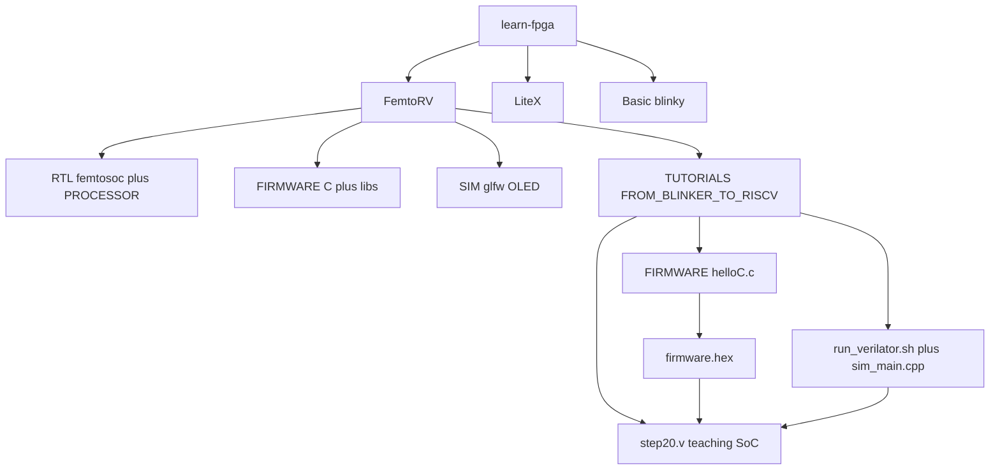
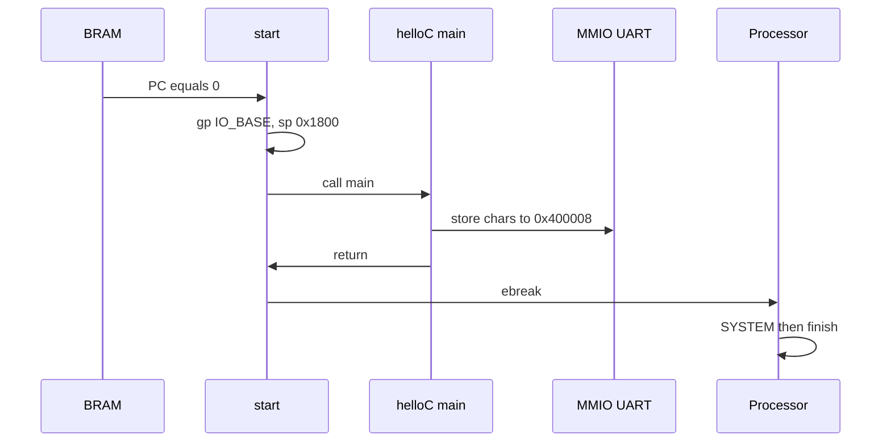

# FemtoRV 学习教程（中文主文档）

面向 Wei 的完整上手说明：从仓库结构、C 固件如何从地址 0 启动，到用
**C 交叉编译 → hex 灌 BRAM → Icarus / Verilator 同镜像仿真** 跑通
`Hello, world !` / `PASS`。

英文摘要：[TUTORIAL.md](TUTORIAL.md)
命令速查：[LEARNING.md](LEARNING.md)
本教程里每一条关键命令都在 [logs/](logs/) 里有**真实终端输出**，不是口头推演。

> 工作分支：`weiwan-gmail/learn-fpga` 的 **develop**（上游为
> [BrunoLevy/learn-fpga](https://github.com/BrunoLevy/learn-fpga)）。
> **不改生产核 RTL**（`FemtoRV/RTL/PROCESSOR/*.v` 保持原样）。只补了系统
> RISC-V GCC 探测、教学 SoC 的 Verilator 5 时钟驱动、一份会退出的 C hello，
> 以及本教程。
>
> 上一档梯子是 picorv32（单文件核 + `mem_valid/ready` / AXI + hex 灌 TB RAM）。
> FemtoRV 是另一种小 RV32：**按规范手写、可读的教学核**，Episode I 从闪灯
> 一步步拼到能跑 GNU 工具链。本档的绿色路径就是 Episode I 的 `step20.v`。

---

## 0. 选了哪种 co-sim，为什么

FemtoRV **本来就**把 C / 汇编编成 `firmware.hex`，SoC 的 BRAM 用 `$readmemh`
灌进去，再用 Icarus（`run.sh`）或 Verilator（`run_verilator.sh`）跑。
`sim_main.cpp` 只负责翻转 `CLK`（Verilog 里的 `#1` 时钟在 Icarus bench 里，
Verilator 用不了）。

所以这里采用 **「C 固件 hex + Verilator C++ 时钟驱动」**，而不是再写一个
C 指令集模拟器去对拍。对这个仓库来说，hex 路径才是自然 co-sim：CPU 真正
执行交叉编译出来的机器码，C++ 侧不是第二套 CPU。

学习用 demo 是 **helloC**（`make test_verilator_hello`）：打印
`Hello, world !` 和 `PASS`，`ebreak` 后仿真结束。汇编版 `hello.S` 会
`j .L0` 死循环，不适合当「绿色命令」。

完整 FemtoSoC（`FemtoRV/RTL/` + `make BENCH`）是另一条路：默认 petitbateau +
OLED，Verilator 要链 GLFW/OpenGL。本教程不把它当作必过命令，以免和
「无显示器的仿真 PASS」搅在一起。LiteX 可以选 FemtoRV 当软核，但需要整套
Python SoC 环境，同样不是本档的绿色路径。

---

## 1. FemtoRV 是什么

Bruno Levy 为「大约 40 美元/学生」写的 **教学用 RISC-V**：Verilog 直接对照
规范，优先可读，而不是把一切塞进一个面积优化的单文件。

| 变体 | ISA | 在哪 |
|------|-----|------|
| 教学 SoC `step20.v` | RV32I，多周期状态机 | `TUTORIALS/FROM_BLINKER_TO_RISCV/` |
| quark | RV32I | `RTL/PROCESSOR/femtorv32_quark.v` |
| electron | RV32IM | `femtorv32_electron.v` |
| intermissum | RV32IM + irq | `femtorv32_intermissum.v` |
| gracilis | RV32IMC + irq | `femtorv32_gracilis.v` |
| petitbateau | RV32IMFC + irq | `femtorv32_petitbateau.v` |

和 picorv32 的差别（本档要记住的）：

- **总线**：教学 SoC 没有 `mem_valid/ready` 握手，是「地址 + rstrb/wmask」的
  简单存储器口；IO 靠地址 bit 22 解码到 `0x400000` 页。
- **写法**：Episode I 带你从 `step1.v` 闪灯写到 `step20.v`；生产核在
  `RTL/PROCESSOR/`，给 IceStick / ULX3S 综合。
- **软件**：教学固件自己实现 `putchar` / 小 `printf`，链接脚本把一切放进
  6KiB BRAM；不是 newlib。

复位后 PC = **0**。教学 TB 里只有：

- `0x00000000` … 6KiB：BRAM（固件 + 数据 + 栈，栈顶 `0x1800`）
- `0x400004`：写 5bit LED
- `0x400008`：写一个字节就打印（仿真里 `$write`，板上是 UART）
- `0x400010`：bit 9 = UART busy



---

## 2. 仓库地图



| 路径 | 干什么 |
|------|--------|
| `FemtoRV/TUTORIALS/FROM_BLINKER_TO_RISCV/step20.v` | 本档仿真顶层：RAM + UART + LED + 多周期 RV32I |
| `sim_main.cpp` | Verilator 顶层：时钟、LED 变化、超时、`gotFinish` |
| `run_verilator.sh` / `run.sh` | 原有封装；现在会 `tee` 到 `sim_hello.last.log` |
| `FIRMWARE/helloC.c` | 一次性 C hello；返回后 `start.S` 执行 `ebreak` |
| `FIRMWARE/start.S` | `gp=0x400000`，`sp=0x1800`，`call main`，`ebreak` |
| `FIRMWARE/bram.ld` | 6KiB BRAM，`start.o` 放在地址 0 |
| `FemtoRV/RTL/PROCESSOR/` | 生产核（本档不改、不作为绿色命令） |
| `FemtoRV/BOARDS/bench.mk` | 全 SoC `make BENCH`（GLFW OLED） |
| `LiteX/` | 用 Python 拼 SoC；可选用 FemtoRV |

---

## 3. CPU 如何“启动”一段 C 固件

仿真和「把 hex 烧进片上 BRAM」是同一条软件路径。

### 3.1 硬件侧

1. C++（或 Icarus `initial`）先 `eval()`，让 `$readmemh("firmware.hex", MEM)`
   跑完。
2. `Clockworks` 在仿真里是透传 PLL；复位计数拉满后 `resetn=1`。
3. CPU 从地址 0 取指。`start.S` 只有几条：设 `gp` / `sp`，`call main`，
   `ebreak`。
4. `BENCH` 下遇到 SYSTEM（`ebreak`）就 `$display` 然后 `$finish()`。

`firmware.hex` 不是 ELF。`firmware_words` 读 ELF，按字写成 `$readmemh`
能吃的 hex（小端 32-bit 一行）。

### 3.2 软件侧（`start.S` + `helloC.c`）



`helloC.c` 自己轮询 UART busy（和 `putchar.S` 同一套 MMIO），打印完
`PASS` 就返回。不要用 `hello.S`：它在 `putstring` 之后 `j .L0`，仿真不会停。

---

## 4. 安装工具

Ubuntu / Debian（本云环境实测：Icarus **12.0**，Verilator **5.020**，
GCC **13.2.0**）：

```bash
sudo apt-get install -y iverilog verilator gcc-riscv64-unknown-elf build-essential
cd FemtoRV
make toolchain-info
```

对应 log：[logs/01-inspect.txt](logs/01-inspect.txt)

```
ARCH=rv32i ABI=ilp32 (teaching SoC step20.v)
riscv64-unknown-elf-gcc: riscv64-unknown-elf-gcc (13.2.0-11ubuntu1+12) 13.2.0
Verilator: Verilator 5.020 2024-01-01 rev (Debian 5.020-1)
Icarus: Icarus Verilog version 12.0 (stable) ()
Using system RISC-V GCC: /usr/bin/riscv64-unknown-elf-gcc
```

### 4.1 工具链从哪来

`FemtoRV/FIRMWARE/makefile.inc` 会按顺序：

1. **系统 GCC**（`riscv64-unknown-elf-gcc` 或 `riscv-none-elf-gcc` 在 PATH 里）
2. 否则下载上游文档里的 SiFive tarball 到 `FIRMWARE/TOOLCHAIN/`（体积大，
   本教程不需要）

强制走 tarball：`make … USE_BUNDLED_TOOLCHAIN=1`。

helloC **不链接 newlib**。不要去编几个小时的完整 RISC-V toolchain，除非你
要给 FPGA 板子上的 femtOS 用 `libc.a`。

教学 SoC 是纯 RV32I。GCC 10+ 把 CSR 拆到 `Zicsr`；`helloC` 不用 `rdcycle`，
所以 `-march=rv32i` 即可。`perf.S` 里的 `rdcycle` 没有链进 hello 镜像。

---

## 5. 绿色命令

在仓库根，或 `cd FemtoRV`：

```bash
make test_verilator_hello
```

等价逐步命令：

```bash
cd FemtoRV/TUTORIALS/FROM_BLINKER_TO_RISCV
make -C FIRMWARE ARCH=rv32i ABI=ilp32 helloC.bram.hex
./run_verilator.sh step20.v
```

同一份 hex 用 Icarus：

```bash
make test_hello
```

### 5.1 期望输出

Verilator（[logs/05-verilator-hello.txt](logs/05-verilator-hello.txt)）：

```
LEDS: 10101
Hello, world !
PASS
LEDS: 11111
EBREAK (SYSTEM) — CPU halted
- step20.v:288: Verilog $finish
SIM DONE after 69170 clock cycles
verilator_exit=0
ALL TESTS PASSED.
```

Icarus（[logs/04-iverilog-hello.txt](logs/04-iverilog-hello.txt)）：同样的
`Hello, world !` / `PASS` / `EBREAK`，然后 `iverilog_exit=0`。

固件构建见 [logs/02-build-hello.txt](logs/02-build-hello.txt)：大约 69 个字
（占用 6KiB BRAM 的 4%）。

---

## 6. 怎样判断 PASS / FAIL

| 检查 | 含义 |
|------|------|
| UART `$write` 出 `Hello, world !` | C 在跑，MMIO 写进了 `0x400008` |
| 一行单独的 `PASS` | `helloC.c` 打完主串 |
| `EBREAK (SYSTEM) — CPU halted` | `start.S` 从 `main` 返回后执行 `ebreak` |
| `SIM DONE after N clock cycles` | Verilator 正常 `$finish`（不是超时） |
| `verilator_exit=0` / `ALL TESTS PASSED.` | Makefile 又 grep 了 log |

失败常见原因：

- 超时（exit 2）：误用了死循环的 `hello.S`，或 hex 没拷到
  `TUTORIALS/FROM_BLINKER_TO_RISCV/firmware.hex`
- 没有 `Hello`：`firmware.hex` 是旧镜像，或 `$readmemh` 找不到文件
  （必须在 `FROM_BLINKER_TO_RISCV/` 下跑 `run_verilator.sh`）
- `rdcycle` 汇编失败：那是 `perf.S`，不要把它链进 hello

---

## 7. 这一档梯子在教什么

tinyriscv 给了你三级流水 + RIB 总线的 MCU 形状；picorv32 给了你单文件核和
`mem_valid/ready`。**FemtoRV 这一档**要带走的是：

1. **按规范手写、能读完的 RV32I**（Episode I 的状态机：取指 → 等指令 →
   取寄存器 → 执行 → load/store）。
2. **自己的 SoC 地图**：6KiB BRAM + `0x400000` IO 页 + 链接脚本，而不是
   别人 TB 里写死的 128KiB + `0x10000000` UART。
3. **C 工具链是一等公民**：`start.S` 调 `main`，小 `printf`，`libgcc`
   补 RV32I 没有的乘除（`sieve.c` 那一步）；hex 灌 RAM 和 FPGA BRAM 初始化
   是同一条路。
4. 后面去看 `RTL/PROCESSOR/` 的 quark → petitbateau，会知道「教学核」和
   「能综合进 IceStick 的核」差在哪里（握手、中断、M/C/F）。

不在本档范围：流水线（Episode II `PIPELINE.md`）、OLED/GLFW 全 SoC、LiteX。

---

## 8. 可选的其它仿真（不是绿色命令）

- **Episode I 更早的 step**：`./run_verilator.sh step18.v` 仍可用；那些
  程序往往死循环闪灯，不会印 `PASS`。
- **`make BENCH`**（`FemtoRV/BOARDS/bench.mk`）：全 FemtoSoC + OLED 窗口，
  依赖 GLFW。固件是 `FIRMWARE/EXAMPLES/hello_bench.c`（`putchar(4)` EOT
  结束仿真）。需要显示器或会在 `glfwInit` 失败。
- **LiteX**：`LiteX/README.md`。安装 LiteX 后可以把 FemtoRV 当 CPU 拼进
  Python SoC；那是另一套仿真/综合流程。

上游 FPGA 流程（`make ICESTICK` 等）没有改目标名。

---

## 9. 下一档

本树变绿之后：

1. **darkriscv** — 传说「一晚写完」的流水线 RV32；对比 FemtoRV 的多周期
   状态机和 picorv32 的单文件风格。
2. **SERV** — 位串行 ALU 的极小核；同一套 RV32I，微结构完全相反。

入口仍是各仓库 `docs/TUTORIAL_zh.md`（中文主文档）。
